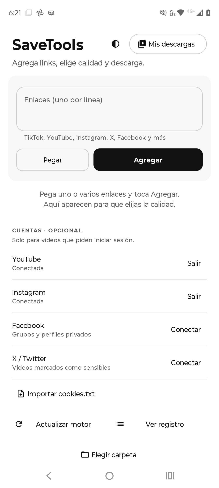

# SaveTools

**Descarga videos a tu Android desde TikTok, YouTube, Instagram, X, Facebook y más. Rápido, directo y sin complicaciones.**

&nbsp;

 

---

## Qué es

SaveTools es una app de Android para descargar videos sin vueltas. Pega uno o varios enlaces, elige la calidad y descarga. También puedes compartir un video desde cualquier otra app y SaveTools lo baja por ti.

## Características

- **Varios a la vez.** Pega varios enlaces (uno por línea) y bájalos en lote.
- **Muchas plataformas.** TikTok, YouTube, Instagram, X (Twitter), Facebook y más.
- **Elige la calidad** antes de descargar.
- **Botón Pegar.** Toma el enlace del portapapeles con un toque.
- **Integración con "Compartir".** Aparece en el menú de Android como *Guardar en SaveTools*, así bajas desde donde sea.
- **Cuentas opcionales.** Inicia sesión (o importa `cookies.txt`) solo para videos que lo piden: reels e historias privadas, publicaciones de grupos, contenido sensible.
- **Mis descargas** y **registro** para llevar control de lo que bajas.

## Descargar

Baja la última versión desde la sección de **[Releases](../../releases/latest)** y toma el archivo `SaveTools-v2.1.apk`.

## Instalar

1. Descarga el APK en tu teléfono.
2. Ábrelo. Si Android lo pide, activa *Instalar apps de orígenes desconocidos*.
3. Toca **Instalar**. Listo.

## Requisitos

| Dato        | Valor                    |
|-------------|--------------------------|
| Android     | 8.0 (API 26) o superior  |
| Versión     | 2.1 (versionCode 10)      |
| Tamaño      | ~58 MB                   |

## Aviso

Descarga únicamente contenido sobre el que tengas derecho. El uso de la app es tu responsabilidad.

---

Hecho por [@emmaenk](https://github.com/emmaenk)

